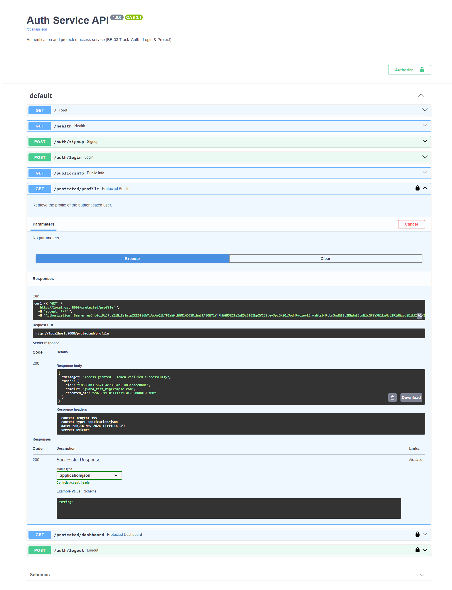

# Auth Service API (Supabase & FastAPI) - BE-03

A Part of the Backend AI Engineering track. A secure authentication and protected access API built with Python and FastAPI, featuring Supabase Auth integration, robust dependency-injected token verification guards, and interactive Swagger UI documentation with Bearer Auth security schemes.

---

## Features

- **User Registration & Authentication:** Secure sign-up (`/auth/signup`) and password-based login (`/auth/login`) backed by Supabase Auth.
- **Reusable Auth Dependency Guard:** Middleware dependency validating JWT bearer tokens (checking token existence, format, structural 3-part split, and live session verification via `supabase.auth.get_user(token)`).
- **Protected Access Control:** Secure routes (`/protected/profile`, `/protected/dashboard`, `/auth/logout`) requiring valid authorization credentials.
- **Interactive Swagger UI Documentation:** Integrated with FastAPI's native `HTTPBearer` security scheme to render visible Authorize padlocks for live in-browser testing.
- **Secure Session Management:** Token-based logout handling and granular `401 Unauthorized` error responses.

## Requirements

- Python 3.10+
- FastAPI
- Uvicorn
- supabase
- Pydantic
- python-dotenv

## Quickstart (Under 5 Minutes Round-Trip)

Clone the repository, configure environment variables, install dependencies, and launch the server:

```bash
git clone [https://github.com/Arghachakraborty05/BE-03-Auth-Login-And-Protect.git](https://github.com/Arghachakraborty05/BE-03-Auth-Login-And-Protect.git)
cd BE-03-Auth-Login-And-Protect
python -m venv .venv
# On Windows:
.venv\Scripts\activate
# On macOS / Linux:
source .venv/bin/activate

pip install -r requirements.txt
cp .env.example .env
```

Populate the `.env` file with the required Supabase credentials, then start the development server:

```bash
uvicorn main:app --reload
```

The API will run at:

`http://localhost:8000`

Interactive Swagger UI documentation is available at:

`http://localhost:8000/docs`

## Environment Variables

Configuration is managed via environment variables. A template is provided in `.env.example`:

- **SUPABASE_URL:** The Supabase project URL.
- **SUPABASE_KEY:** The Supabase project public anon/API key.

The `.env` file is git-ignored, while `.env.example` is committed to the repository.

## API Endpoints

| Method |        Endpoint        |                      Description                       | Access Type  |
|--------|------------------------|--------------------------------------------------------|--------------|
|  GET   | `/`                    |      Get API information and available endpoints       |    Public    |
|  GET   | `/health`              |            Check whether the API is running            |    Public    |
|  POST  | `/auth/signup`         |         Register a new user with Supabase Auth         |    Public    |
|  POST  | `/auth/login`          | Authenticate user and return JWT access/refresh tokens |    Public    |
|  GET   | `/public/info`         |           Public welcome information endpoint          |    Public    |
|  GET   | `/protected/profile`   |       Retrieve profile of the authenticated user       | Bearer Token |
|  GET   | `/protected/dashboard` |       Retrieve secure user dashboard and metrics       | Bearer Token |
|  POST  | `/auth/logout`         |           Sign out the current user session            | Bearer Token |

## Interactive Documentation & Bearer Auth Proof

The API utilizes FastAPI's built-in Swagger UI configured with `HTTPBearer` security schemes to render visible padlocks on protected routes.

Open:

`http://localhost:8000/docs`

Swagger UI proof showing the active Authorize padlock and a successful verified `200 OK` response for the protected profile endpoint:



## Project Structure

```text
BE-03-Auth-Login-And-Protect/
├── main.py
├── requirements.txt
├── .env.example
├── .gitignore
├── README.md
└── screenshots/
    └── swagger-ui.png
```